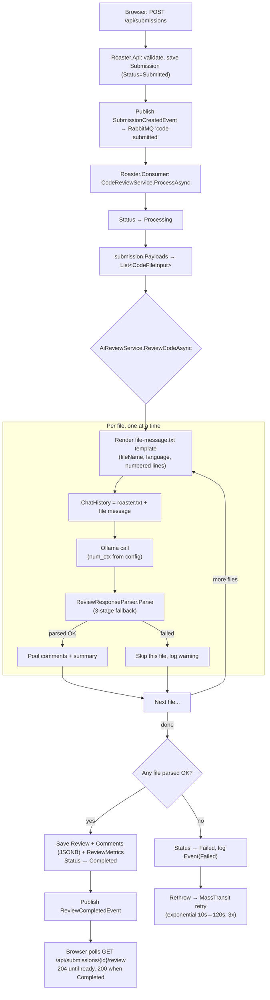
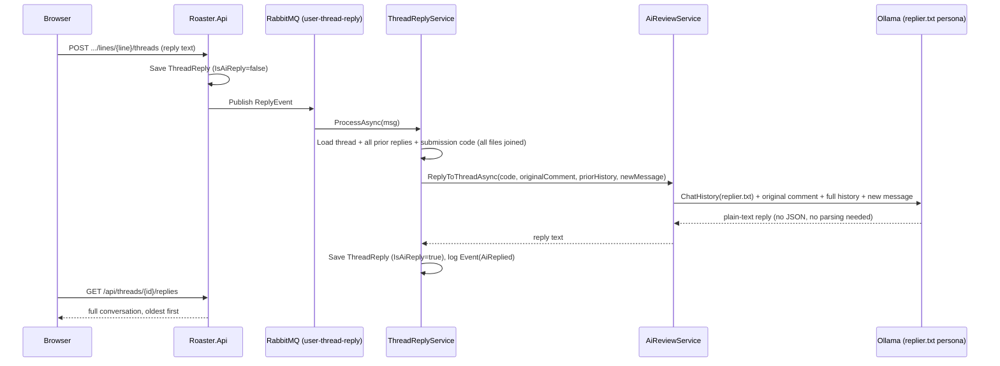

# Roaster — AI Pipeline Deep Dive (Interview Prep)

Scope: **only the AI part** — how code actually gets from a submission to a review, in detail. Backend/frontend
plumbing is covered in `Documentations/BACKEND.md` / `FRONTEND.md` — not repeated here.

---

## 1. The AI part in one sentence

`Roaster.Reviewer` is a small class library — `AiReviewService` — that talks to a **local Ollama model** through
**Semantic Kernel's `IChatCompletionService`**. It reviews a submission **one file at a time** (not one prompt for
everything), using one of **two fixed system prompts** depending on what's being asked: an initial review, or a
reply inside an existing comment thread.

There is no agent framework, no planner, no tool use, no memory store. Two prompt *personas* sharing one call
mechanism — that's the whole "multi-agent" story, and it's worth being precise about that distinction going into
an interview (see §5).

---

## 2. Where the AI code lives

| Piece | File | Role |
|---|---|---|
| Interface | `Abstractions/IAiReviewService.cs` | `ReviewCodeAsync(files)` and `ReplyToThreadAsync(...)` — the only two entry points |
| Implementation | `Services/AiReviewService.cs` | Owns the per-file loop, prompt selection, template rendering, calling Ollama, merging results |
| Defensive parser | `Services/ReviewResponseParser.cs` | Turns a raw model response into a typed result, never throws |
| Prompts (embedded resources) | `Prompts/roaster.txt`, `Prompts/replier.txt`, `Prompts/file-message.txt` | The two system-prompt personas + one structural user-message template |
| DI wiring | `ReviewerExtensions.cs` | Builds the Ollama connector + `AiReviewService` singleton |
| Config | `Options/OllamaOptions.cs` | `Endpoint`, `ModelId`, `ContextLength` — all required, all from config |

Callers: `Roaster.Consumer/Services/CodeReviewService.cs` (initial review) and
`Roaster.Consumer/Services/ThreadReplyService.cs` (thread replies). Both run inside the background worker, never
inside the API process — the API only ever publishes an event and lets the consumer do the AI work.

---

## 3. Initial review — file-by-file, not one giant prompt

### 3.1 Why per-file

A submission can carry multiple files (`Submission.Payloads: List<Payload>`). Earlier this project concatenated
**every** file into a single prompt — one call, one shared context window across all files. That broke down as
soon as total size grew: the whole submission's size determined whether a single call would overflow the model's
context. It's now **one Ollama call per file**, so submission size no longer matters — only each individual
file's size does.

### 3.2 The actual loop — `AiReviewService.ReviewCodeAsync`

```
foreach (file in files):
    history = new ChatHistory(roaster.txt)              # fresh system prompt each time
    history.AddUserMessage( render(file-message.txt, { fileName, language, numberedContent }) )
    response = chat.GetChatMessageContentsAsync(history, executionSettings)
    result = ReviewResponseParser.Parse(response)
    if result failed to parse → log + skip this file, keep going
    else → pool its comments, keep its summary (prefixed with the file name)

overall status = Success if ANY file parsed, Failed only if EVERY file failed
```

Each file is judged in **complete isolation** — the model reviewing `Bar.cs` never sees `Foo.cs` in the same
call. That's the direct trade-off of per-file chunking: it fixed the context-overflow risk but removed any
possibility of cross-file reasoning (a bug that only shows up when two files are read together can't be caught).
Tool-calling-based cross-file retrieval was evaluated as the fix and shelved — see §6.

### 3.3 Building the per-file message — line numbers matter

Before sending, the file's content is split into lines and each is prefixed with its 1-indexed line number:

```
   1 | using System;
   2 |
   3 | public class Foo
```

This is **the entire reason the model can return accurate `lineNumber` values** — it's echoing numbers it was
literally shown in the prompt, not computing them from scratch. The numbered content, file name, and language are
then rendered through an SK prompt template (`file-message.txt`, using `{{$fileName}}` / `{{$language}}` /
`{{$numberedContent}}` placeholders) instead of hand-built string concatenation — SK's
`KernelPromptTemplateFactory` owns the declarative shape, the line-numbering itself stays procedural code because
a template can't do that part.

### 3.4 The system prompt (`roaster.txt`) — the "review" persona

- Persona: senior engineer doing a real review, who can't resist a sarcastic joke on every comment.
- Hard requirement: **return only a JSON object**, no markdown fences, no prose outside it:
  ```json
  { "summary": "...", "comments": [{ "fileName": "X.cs", "lineNumber": 5, "comment": "...", "severity": 10 }] }
  ```
- `severity` is a fixed two-value enum: `10` = should-fix, `20` = must-fix (bug / security / serious design).
- `fileName` must match the file header exactly — this is what lets the consumer attribute a comment back to the
  right `Payload` row when merging results across files.
- If nothing is wrong: empty `comments` array + a genuinely positive summary — the model is told not to invent
  problems to pad the response.

### 3.5 Execution settings — `num_ctx` is explicit, not assumed

Every call passes `OllamaPromptExecutionSettings { ExtensionData = { ["num_ctx"] = contextLength } }`, where
`contextLength` comes from `Ollama:ContextLength` in config (`OllamaOptions.ContextLength`, a **required** field —
no silent default in code). This was verified end-to-end by intercepting the real outgoing HTTP request: the value
lands under `options.num_ctx` in Ollama's `/api/chat` body. It's required per-deployment because different models
need different context budgets — a 3B model and a 7B model don't share a sane default.

What's still not covered: nothing counts tokens before sending. If a single file's content alone exceeds
`ContextLength`, Ollama still truncates silently — chunking shrank the blast radius from "whole submission" to
"one file," it didn't eliminate the risk.

### 3.6 Merging results back together

`ReviewCodeAsync` returns one `ReviewerResult` for the whole submission, built by:
- pooling every file's `AiLineComment` list into one `List<AiLineComment>`
- joining each file's summary as `"fileName: summary"`, one line per file
- marking the whole review `Failed` only if **every** file's response failed to parse — one bad file doesn't
  sink the other nine

The consumer (`CodeReviewService.ProcessAsync`) then defaults any comment missing a `fileName` to the first file
in the submission (defensive fallback, logged as a warning — the prompt says `fileName` is mandatory, but nothing
guarantees the model obeys).

---

## 4. Thread replies — the second persona

### 4.1 When this runs

A user replies to a specific line comment → API creates a `ThreadReply` row + publishes a `ReplyEvent` →
`ThreadReplyService.ProcessAsync` (in the Consumer) picks it up.

### 4.2 Building the call

```
code            = ALL of the submission's files' content, joined together        ← see the caveat below
originalComment = the review comment that started this thread (looked up by LineNumber)
priorHistory    = every ThreadReply on this thread so far, mapped user/assistant, oldest first
userMessage     = the newest user reply (the one that triggered this event)

chatHistory = new ChatHistory(replier.txt)
chatHistory.AddUserMessage("Code:\n{code}\n\nOriginal comment: {originalComment}")
chatHistory.AddAssistantMessage(originalComment)
foreach prior message → chatHistory.Add{User|Assistant}Message(...)
chatHistory.AddUserMessage(userMessage)

reply = chat.GetChatMessageContentsAsync(chatHistory, executionSettings)
```

**Honest gap worth knowing:** `code` is every file in the submission concatenated together
(`string.Join("\n\n", submission.Payloads.Select(f => f.Content))`), not just the one file the comment lives in.
For a multi-file submission this resends the whole submission's code on every single reply — larger prompts than
necessary, and another way a big enough submission could threaten the context window on this path specifically.

### 4.3 The system prompt (`replier.txt`) — the "reply" persona

- Persona: the same reviewer, now defending their original comment against pushback — sarcastic, argumentative,
  not conceding easily.
- **Plain text only** — explicitly no JSON, no markdown headers. This is a deliberate contrast with the review
  prompt: a conversational reply has no structured contract to satisfy, so there's nothing for a parser to do
  here — the raw model output *is* the saved `ThreadReply.Content`.
- Explicitly told not to repeat the original comment verbatim — it should escalate or redirect instead.

### 4.4 Why two separate prompts instead of one shared one

Different output contracts (strict JSON vs. free text) and different conversational shapes (single-shot review vs.
multi-turn argument) don't compress into one prompt without one of them fighting the other's instructions. Keeping
them as two small, single-purpose prompt files is the simpler option — no runtime branching logic inside a shared
prompt, no risk of the JSON-mode instructions leaking into a reply.

---

## 5. "Agents" — precise language for the interview

If asked "how many agents does this use" or similar: **there are two distinct system-prompt configurations
(review vs. reply), not two autonomous agents.** Both go through the exact same underlying mechanism —
`IChatCompletionService.GetChatMessageContentsAsync` — with a different `ChatHistory` seed and a different parsing
strategy afterward. Neither one:
- calls tools or functions,
- runs a planning/reasoning loop,
- maintains memory beyond the conversation history explicitly passed in,
- decides on its own what to do next.

The only "decision" logic is in application code (`AiReviewService`, `CodeReviewService`, `ThreadReplyService`),
not inside the model. Calling this "two agents" in an interview is fine as shorthand as long as you can
immediately clarify it's two prompt personas over one shared client, not an agentic architecture — that
precision is exactly the kind of thing a good interviewer will probe.

---

## 6. What was tried and shelved — tool-calling doesn't work here

Before settling on the per-file/two-persona design above, real function-calling was tested as a way to let the
model fetch other files on demand (fixing the cross-file blind spot from §3.2). Tested directly, twice, against
the actual models this project runs:

- Raw Ollama `/api/chat` with a `tools` array → model printed function-call-shaped JSON as plain **text**,
  `tool_calls` field never populated.
- Full Semantic Kernel `Kernel` + `FunctionChoiceBehavior.Auto()` with a real registered function → same
  degradation; the function was never actually invoked.
- `ollama show qwen2.5-coder:3b` claims a `tools` capability — misleading in practice, given the above.
  `deepseek-coder:1.3b` (the local dev default) doesn't even claim it.

Conclusion: real tool-calling isn't usable with these models, so cross-file retrieval and tool-forced structured
output were both shelved rather than half-built on a foundation that doesn't hold. What shipped instead — per-file
chunking, explicit `num_ctx`, prompt templates — works with the models actually in use today.

---

## 7. Defensive JSON parsing — the real reliability layer

A 3B-class local model is not a guaranteed structured-output engine. `ReviewResponseParser.Parse` is a 3-stage
fallback that never throws:

1. Direct `JsonSerializer.Deserialize` on the raw response.
2. Strip a ```` ```json ... ``` ```` fence via regex, retry.
3. Take the substring from the first `{` to the last `}`, retry.
4. Give up → `ReviewStatus.Failed`, empty comment list, logged with the raw response (truncated to 500 chars).

This is the single most load-bearing piece of resilience in the whole AI path — without it, any time the model
wraps its JSON in a sentence or a code fence, the entire file's review would hard-fail instead of degrading
gracefully.

---

## 8. System flow (Mermaid)

### 8.1 Initial review — submission to saved review



### 8.2 Thread reply — user pushes back on a comment



---

## 9. Likely interview questions this doc answers

- "Walk me through what happens between hitting Submit and seeing a review." → §8.1
- "How does multi-file review actually work under the hood?" → §3
- "You mentioned agents — how many, and what do they actually do?" → §5
- "What happens if the model doesn't return valid JSON?" → §7
- "Did you consider giving the model tools to look at other files?" → §6
- "How do you control how much code the model can see at once?" → §3.5
- "What's the weakest part of the reply flow?" → §4.2 (resending full submission code per reply)
