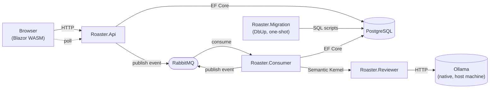
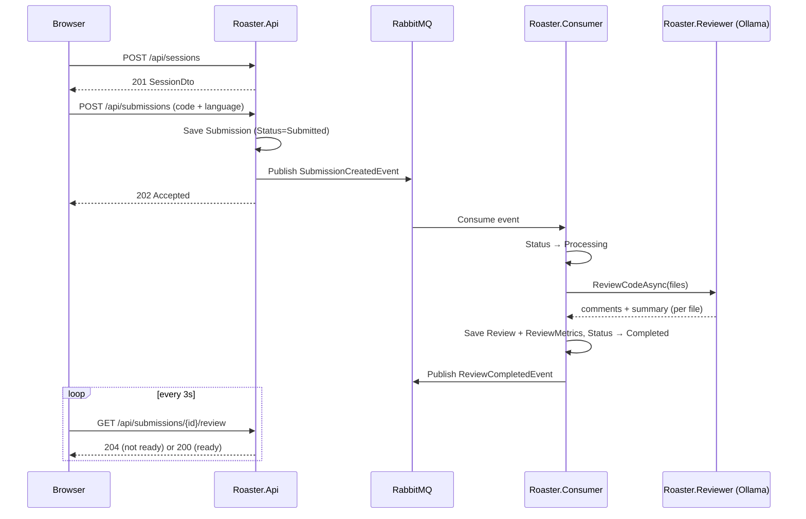
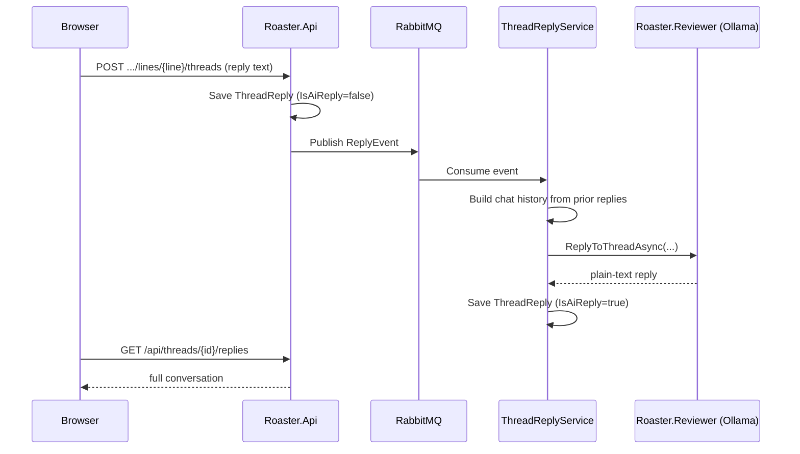
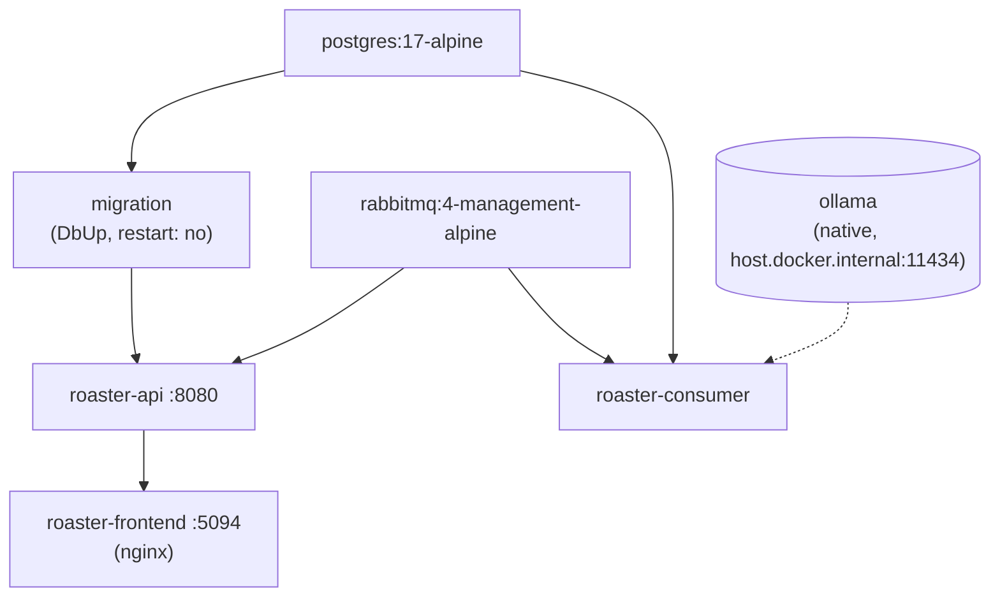

# 2. Architecture

## System Diagram

Everything except Ollama runs in Docker. Ollama runs natively on the host so it can use Apple
Silicon/GPU acceleration — the Consumer reaches it via `host.docker.internal:11434`.

## Request Lifecycle

## Thread Replies

## Docker Compose Topology

## Key Architectural Decisions

- **1 session : 1 live submission.** `Submission.SessionId` is a unique FK; resubmitting replaces
  the payload and drops the old review rather than creating a new submission row.
- **Per-file AI review, not one giant prompt.** Each file in a multi-file submission gets its own
  Ollama call and its own system-prompt context — one oversized file can't blow the context budget
  for the rest of the submission. See [05-ai-pipeline.md](05-ai-pipeline.md).
- **Defensive JSON parsing, never throws.** The AI is not a guaranteed structured-output engine;
  parsing degrades through multiple fallback stages instead of failing the whole review.
- **Soft delete for sessions.** `IsActive` flag, never a hard delete — audit `Event` rows always
  stay valid.
- **CorrelationId = SessionId.** `Event.CorrelationId` is the session's UUID, not the HTTP
  correlation header — it's the stable identifier for grouping a session's full history.
