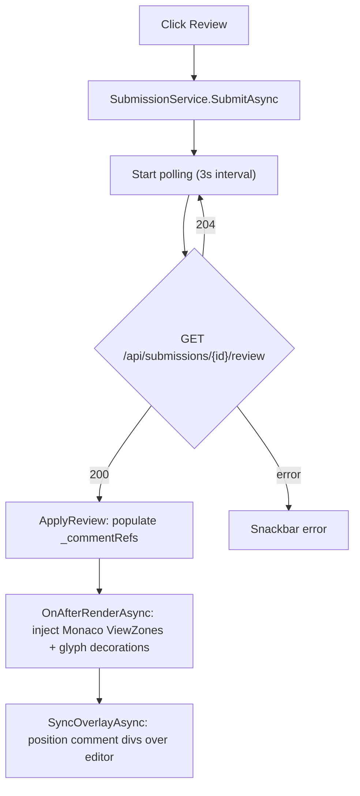

# 4. Frontend (Roaster.Editor)

Blazor **WebAssembly** (.NET 10), runs entirely in the browser. API base URL:
`wwwroot/appsettings.json` → `Api:BaseUrl` (default `http://localhost:8080`).

## Structure

```
src/Roaster.Editor/
├── Pages/
│   ├── Index.razor      "/"                session dashboard, owns all action handlers
│   ├── Session.razor    "/session/{Id}"    session detail + <Code /> editor
│   └── Events.razor     "/events"          audit log, <JsonViewer /> for metadata
├── Components/
│   ├── Code.razor       Monaco wrapper — submit, poll, overlay review comments
│   ├── Comment.razor    inline comment: severity badge, collapse, reply thread
│   ├── JsonViewer.razor generic JSON tree viewer
│   └── SessionView.razor MudDataGrid of sessions
├── Shared/
│   ├── NewSessionDialog.razor
│   └── EditorComponentBase.cs   Running flag, RunLogException, injected services
├── Layout/MainLayout.razor      shell, dark/light toggle, fixed-height flex content area
├── Services/  SessionService · SubmissionService · ReviewService · CodeUtils · ThemeFactory
└── wwwroot/reviewZones.js       Monaco ViewZone + overlay positioning interop
```

## Review Flow (`Code.razor`)



**Overlay architecture.** Comment components render in a sibling `<div>` positioned absolutely
over Monaco (not inside its DOM). Monaco ViewZones create invisible gutter spacers;
`RoasterReview.syncOverlay` (in `reviewZones.js`) positions each comment by reading
`getTopForLineNumber()` / `getScrollTop()`. Wheel events on the overlay forward to Monaco.

```
top  = editor.getTopForLineNumber(lineNum + 1) - zoneHeight - scrollTop
left = editor.getLayoutInfo().contentLeft
```

## Services

All typed `HttpClient` services return `ApiResponse<T>` (2xx → `IsSuccess=true` + `Data`; 204 →
`IsSuccess=true` + `Data=default`; 4xx/5xx → `IsSuccess=false` + `Error`).

| Service | Calls |
|---|---|
| `SessionService` | GET list/by-id, POST, DELETE `/api/sessions` |
| `SubmissionService` | POST `/api/submissions` |
| `ReviewService` | GET review, POST reply, GET replies, PATCH resolve |

## Conventions

- MudBlazor bindings: `@bind-Value` + `@bind-Value:after` (not `Value` + `ValueChanged`).
- Child components emit `EventCallback<T>` only — no decision logic in children (e.g. `Index.razor`
  owns all session new/edit/delete handling).
- All editor JS interop goes through `CodeUtils` static methods, never `JS.InvokeAsync` directly
  from a component.
- Post-render side effects (e.g. zone resize after collapsing a comment) use a `_pendingFlag` set
  synchronously, then acted on in `OnAfterRenderAsync` once the DOM reflects the new state.
- UI libraries: MudBlazor 9.4.0, BlazorMonaco 3.4.0 — no CDN dependencies.
