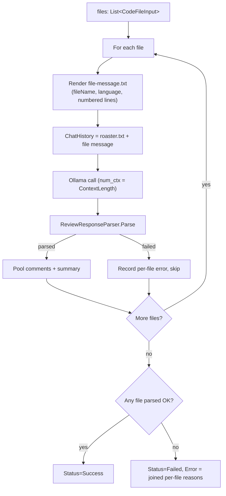

# 5. AI Pipeline

`Roaster.Reviewer` — `AiReviewService` — talks to a local Ollama model through Semantic Kernel's
`IChatCompletionService`. Code is reviewed **one file at a time**, using one of two fixed system
prompts: an initial review, or a reply inside an existing comment thread. There is no agent
framework, planner, tool use, or memory store — two prompt *personas* sharing one call mechanism.

## Where the Code Lives

| Piece | File | Role |
|---|---|---|
| Interface | `Abstractions/IAiReviewService.cs` | `ReviewCodeAsync`, `ReplyToThreadAsync` |
| Implementation | `Services/AiReviewService.cs` | Per-file loop, prompt selection, calling Ollama |
| Parser | `Services/ReviewResponseParser.cs` | Raw response → typed result, never throws |
| Prompts | `Prompts/roaster.txt`, `Prompts/replier.txt`, `Prompts/file-message.txt` | Two personas + one template |
| Config | `Options/OllamaOptions.cs` | `Endpoint`, `ModelId`, `ContextLength` (required, no default) |

Callers: `Roaster.Consumer/Services/CodeReviewService.cs` (review) and `ThreadReplyService.cs`
(replies) — both run in the background worker, never the API process.

## Initial Review — Per-File Loop



Each file is judged in isolation — the model reviewing `Bar.cs` never sees `Foo.cs`. This bounds
the context-overflow risk to a single file's size instead of the whole submission's, at the cost of
cross-file reasoning.

**Line numbering.** Content is split into lines, each prefixed `"{n,4} | {line}"` before being sent
— this is the entire reason the model can return accurate `lineNumber` values; it echoes numbers it
was shown, not values it computes.

**`roaster.txt` persona.** Senior engineer, sarcastic. Must return only JSON:
`{"summary": "...", "comments": [{"fileName", "lineNumber", "comment", "severity"}]}`.
`severity`: `10` = should-fix, `20` = must-fix. `fileName` must match the file header exactly.

## Context Length (`num_ctx`)

Every call passes `OllamaPromptExecutionSettings { ["num_ctx"] = ContextLength }`. Default **8096**
(`docker-compose.yml` → `OLLAMA_CONTEXT_LENGTH`, `appsettings.json` for local dev). This budget is
shared by the prompt (system prompt + one file's numbered content) and the response. `qwen2.5-coder`
models natively support up to 32,768 tokens — the ceiling here is a deliberate memory/quality
tradeoff, not a model limit.

If a single file's content pushes the prompt at/over `ContextLength`, Ollama truncates silently.
`AiReviewService` detects this (`PromptTokens >= ContextLength`) and prefixes the per-file error
with a "prompt used X/Y context tokens — input likely too large" hint, so a truncation failure
reads differently from a genuine malformed-JSON failure in the Events UI.

## Defensive JSON Parsing

`ReviewResponseParser.Parse` — 4-stage fallback, never throws:

1. Direct `JsonSerializer.Deserialize`.
2. Strip a ` ```json ... ``` ` fence via regex, retry.
3. Substring from first `{` to last `}`, retry.
4. Escape raw `\n`/`\r`/`\t` found inside string literals (small models often break JSON this way
   when a comment spans multiple lines), retry.

On total failure: the real `JsonException` message + a 500-char raw-response snippet becomes
`ReviewerResult.Error`, which flows up to the `Event(Failed)` row's `Metadata` — visible in the UI,
not a generic placeholder.

## Thread Replies — Second Persona

```
code            = ALL files in the submission, joined together
originalComment = the review comment that started this thread
priorHistory    = every prior ThreadReply, oldest first
userMessage     = the newest reply

ChatHistory(replier.txt)
  + "Code:\n{code}\n\nOriginal comment: {originalComment}"
  + assistant(originalComment)
  + priorHistory (user/assistant alternating)
  + user(userMessage)
→ Ollama → plain-text reply (no JSON, no parsing)
```

`replier.txt` persona: the same reviewer defending their comment — sarcastic, not conceding easily,
plain text only (no structured contract, so nothing to parse).

**Known limitation.** `code` is every file in the submission concatenated, not just the file the
comment is in — a multi-file submission resends its full code on every reply.

## "How many agents?"

Two system-prompt *configurations*, not two autonomous agents. Both go through the same
`IChatCompletionService.GetChatMessageContentsAsync` call — neither calls tools/functions, runs a
planning loop, or maintains memory beyond the explicit `ChatHistory` passed in. All decision logic
(`AiReviewService`, `CodeReviewService`, `ThreadReplyService`) lives in application code.

## Tool-Calling — Tried and Shelved

Real function-calling was tested (to let the model fetch other files on demand) against
`qwen2.5-coder:3b` and `deepseek-coder:1.3b`: raw Ollama `tools` array and full Semantic Kernel
`FunctionChoiceBehavior.Auto()` both produced function-call-shaped **text**, never an actual
invocation. Not usable with these models — cross-file retrieval was shelved rather than half-built.
