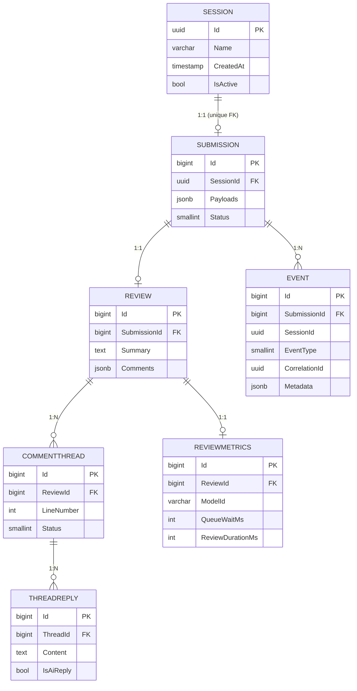

# 6. Data Model

## Entity Relationship Diagram

## Enum Values (all `smallint`)

| Enum | Values |
|---|---|
| `SubmissionStatus` | 10=Submitted, 20=Processing, 30=Completed, 40=Failed |
| `ThreadStatus` | 10=Unresolved (default), 20=Resolved |
| `ReviewSeverity` | 10=Gentle, 20=Medium, 30=Brutal |
| `EventType` | 10=Submitted, 20=ProcessingStarted, 30=ReviewCompleted, 40=Failed, 50=UserReplied, 60=AiReplied |

## JSONB Owned Types

- `Submission.Payloads` → `List<Payload{FileName, Content, Language}>` — one entry per file.
- `Review.Comments` → `List<ReviewLineComment{FileName, LineNumber, Comment, Severity}>`.
- `Event.Metadata` → arbitrary JSON — token usage on success, real parser/exception error on
  failure. Rendered in the UI via `JsonViewer.razor`.
