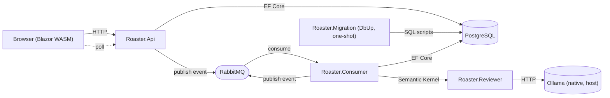
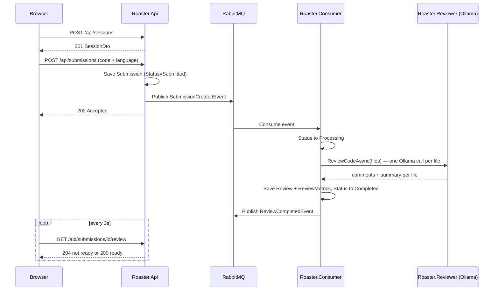

# Roaster

AI-powered code review: paste code into a Monaco editor, submit it, and a local Ollama LLM drops
sarcastic-but-accurate inline comments on the lines that deserve it. Reply to a comment and the AI
argues back in a threaded conversation.

Full docs: [`Documentations/`](Documentations/01-overview.md) (or open [`Documentations/index.html`](Documentations/index.html) as one page).

## Overview

| Layer | Technology |
|---|---|
| Frontend | Blazor WebAssembly (.NET 10), Monaco Editor, MudBlazor |
| API | ASP.NET Core 10 Minimal APIs |
| Worker | .NET Worker Service + MassTransit |
| AI | Semantic Kernel → Ollama (local LLM, default `qwen2.5-coder:3b`) |
| Broker | RabbitMQ |
| Database | PostgreSQL + EF Core (JSONB for code payload and review comments) |
| Migrations | DbUp (plain SQL scripts, one-shot init container) |

## System Architecture



Everything except Ollama runs in Docker. Ollama runs natively on the host for GPU/Apple Silicon
acceleration — the Consumer reaches it via `host.docker.internal:11434`.

## Design: Request Lifecycle



Design notes:
- **Per-file AI review, not one giant prompt** — each file in a submission gets its own Ollama
  call and context budget, so one large file can't blow the review for the rest.
- **1 session : 1 live submission** — resubmitting replaces the payload and drops the old review.
- **Defensive JSON parsing** — the AI response is never trusted as valid JSON; parsing degrades
  through fallback stages instead of failing the whole review. Full detail:
  [`05-ai-pipeline.md`](Documentations/05-ai-pipeline.md).
- **Soft delete** — sessions use an `IsActive` flag; audit `Event` rows always stay valid.

## Project Structure

```
src/
  Roaster.Api          — HTTP endpoints, validation, event publishing
  Roaster.Consumer     — RabbitMQ consumer, orchestrates AI review flow
  Roaster.Reviewer     — Semantic Kernel + Ollama integration
  Roaster.Data         — EF Core DbContext and entity configs
  Roaster.Contracts    — Shared events and DTOs
  Roaster.Migration    — DbUp console app, runs SQL scripts on startup
  Roaster.Editor       — Blazor WASM frontend
tests/
  Roaster.Api.Tests
  Roaster.Consumer.Tests
  Roaster.Reviewer.Tests
  Roaster.Data.Tests
docker/
  Dockerfile.api · Dockerfile.consumer · Dockerfile.migration · Dockerfile.frontend · nginx.conf
docker-compose.yml
```

## Getting Started

See [`Documentations/07-running.md`](Documentations/07-running.md) for the full setup guide. Short version:

```bash
# 1. Start Ollama natively (runs outside Docker so it can use GPU/Apple Silicon)
ollama serve
ollama pull qwen2.5-coder:3b

# 2. Build and start everything
make up
```

Then open http://localhost:5094.

## Ports

| Service | Port |
|---|---|
| Frontend | 5094 |
| API | 8080 |
| RabbitMQ Management | 15672 |
